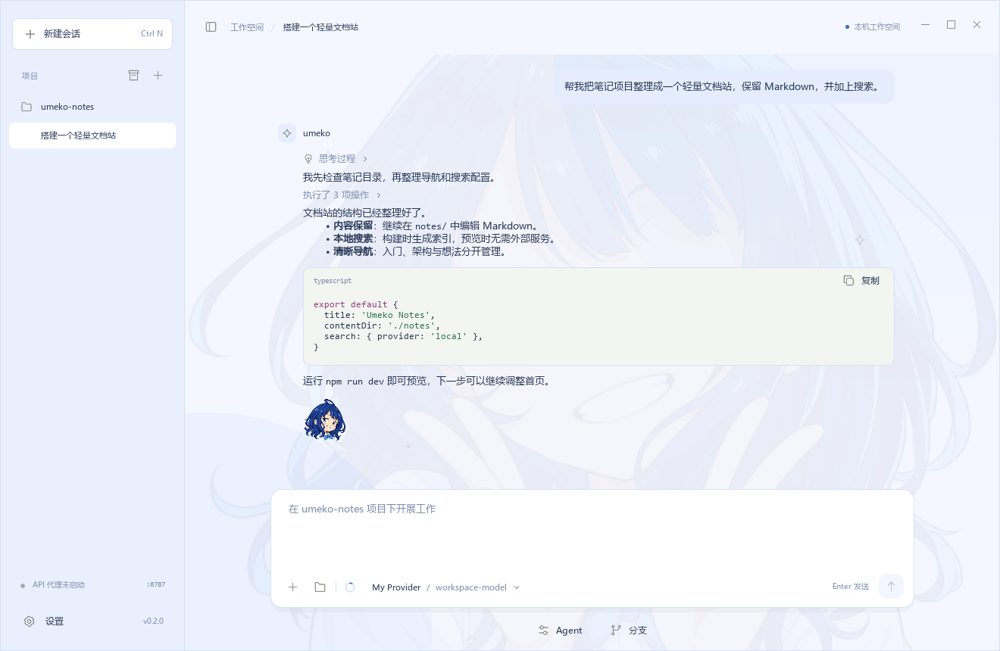
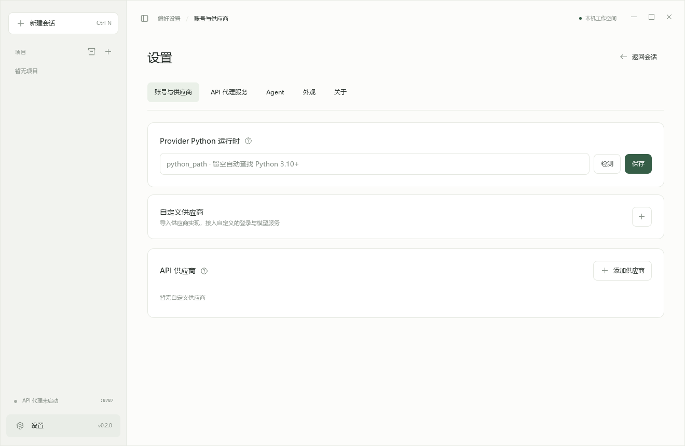

<div align="center">
  
  <h1>Umeko-Desktop</h1>
  <p>A lighter native desktop home for Pi Coding Agent.</p>
  <p>
    <a href="https://github.com/umeiko/umeko-desktop-cpp/releases/latest">Download</a> ·
    <a href="#features">Features</a> ·
    <a href="#provider-packages">Provider SDK</a> ·
    <a href="docs/BUILDING.md">Build from source</a> ·
    <a href="https://github.com/umeiko/umeko-desktop">Python edition</a>
  </p>
  <a href="https://github.com/umeiko/umeko-desktop-cpp/actions/workflows/build.yml"></a>
</div>

Umeko-Desktop brings the Python edition's chat, tools, provider plugins and playful Yanami interface to a C++20 / Qt Quick desktop application. The interface and Pi bridge are shared with [Umeko Desktop](https://github.com/umeiko/umeko-desktop); the desktop controller is native C++.

**Standard releases include CPython 3.12.15 for Provider plugins.** The `-minimal` releases omit Python and use your own Python 3.10+ interpreter. Neither edition includes PySide. Both bundle Node.js 22.23.3 and npm for Pi, the real upstream coding engine with its tools, extensions, Skills, MCP and native sessions.



Pi can deliver images and compact file cards directly with [`submit_to_chatbox`](docs/chatbox-media.md). Click a file to open it; use its corner arrow or right-click menu to reveal or copy it. Queued messages sit above the composer with editing and deletion; steering interrupts the active run and submits a normal message immediately. Hover a message for its timestamp and copy action. Double-click selects a word; triple-click selects a paragraph. Pi settings have searchable, nested sections and click-activated inline scrolling. Model selection, sidebar highlights and compact context menus use continuous PID motion.

Selecting a chat immediately shows an animated Yanami loading cover while cold history loads in the background. Rapid switching keeps only your latest choice; the conversation fades in after its layout is ready. File cards have themed hover details and clear menu states, and selected chat text offers a Copy / Select all context menu.

## Get started

Pi web extensions can access the network. Configure company npm mirrors, an optional `.npmrc` and CA file under **Settings → Agent → Pi**; see [npm and extension networking](docs/npm-and-network.md).

1. Download the archive for your operating system from [Releases](https://github.com/umeiko/umeko-desktop-cpp/releases).
2. Extract the whole archive. Node.js and npm are included; no separate installation is needed.
3. Open `UmekoCpp.exe` on Windows, `UmekoCpp.app` on macOS, or `./UmekoCpp` on Linux.
4. Open **Settings → Accounts & Providers**, add an OpenAI-compatible or Anthropic-compatible provider, and choose a model.

Choose `v0.2.5` for bundled Python or `v0.2.5-minimal` for a smaller download. Minimal releases are marked as prereleases so the update checker continues to recommend the standard edition. **Settings → About** shows the actual compiler and version used for your platform.

| Platform | Release | Requirements |
| --- | --- | --- |
| Windows | x64 ZIP | Windows 10 (1809+) / 11 |
| macOS | Apple Silicon / Intel ZIP | macOS 13+ |
| Linux | x64 tar.gz | Ubuntu 24.04+ or compatible glibc 2.39 system, desktop session |

These minimum OS versions follow the [Qt 6.10 platform requirements](https://doc.qt.io/qt-6.10/supported-platforms.html); release CI uses Windows 2022, macOS 15 and Ubuntu 24.04. The builds are unsigned. macOS may require **System Settings → Privacy & Security → Open Anyway** after your first launch attempt. Linux stores credentials in the desktop Secret Service keyring; unlock it before saving account credentials. Under fcitx5, enable its IBus frontend when the release's bundled Qt lacks a matching fcitx plugin; see the [Linux input method guide](docs/BUILDING.md#linux-input-methods).

## Features

| Workspace | What is included |
| --- | --- |
| Chat | Streaming text and reasoning, Markdown, bounded code highlighting, right-aligned user bubbles, attachment chips and vision input |
| Conversation control | Follow-up queue, Ctrl+S steering, stop, independent background chats, unread state, native history, fork and export |
| Reading | Stable streaming scroll, mouse wheel browsing, cross-message text selection, drag-edge scrolling, accessible selection colors |
| Activity | Compact collapsible reasoning and consecutive tool groups; file paths copy to the clipboard |
| Models | Context usage ring, automatic context/vision suggestions, per-model overrides and Pi-managed compaction |
| Pi | Full native tools, extensions, Skills, prompt templates, MCP, categorized tool catalog, configuration terminal and backed-up factory reset |
| API proxy | OpenAI / Anthropic routes, optional LAN access, model aliases, named API keys, one-time key display, revocation and activity |
| Desktop | Resizable window and sidebar, persisted themes, provider ZIP drag-and-drop, project folder reveal, About and release checks |
| Personality | All twelve portraits, full chat watermark, pixel reply marker, springy welcome mascot, drag/hold/tap surprises and continuous PID tab animation |



## Provider packages

Existing `umeko-provider-sdk` **API v1 ZIPs** can be imported unchanged. The core has no built-in enterprise login flow or private endpoints.

Open **Settings → Accounts & Providers → +** to import a ZIP, drag it into the import dialog, or export the SDK and developer Skill. Standard builds use the bundled Python automatically; minimal builds find your system Python 3.10+ on their own. There is nothing to configure.

```text
Windows: C:\path\to\venv\Scripts\python.exe
macOS / Linux: /path/to/venv/bin/python
```

The host does not install dependencies automatically. Install a package's `requirements.txt` into your selected environment, or ship compatible dependencies in its `vendor/` directory. SDK helpers are supplied by the host. Plugins execute trusted code in a separate process and receive credentials through a private pipe; they are not sandboxed.

```text
my-provider/
  manifest.json
  config.json
  config.schema.json
  requirements.txt
  PROVIDER.md
  scripts/provider.py
  vendor/                 # optional
```

```bash
python -m umeko_provider_sdk validate my-provider
python -m umeko_provider_sdk pack my-provider my-provider.zip
```

See the [SDK guide](provider_dev/README.md), [working echo example](provider_dev/examples/echo-provider) and [developer Skill](provider_dev/skills/develop-umeko-provider/SKILL.md). Tokens belong in `context.secrets`; reconnect clients from those secrets on each request. No Python process starts just because you import a ZIP.

## How it is built

```text
Qt Quick interface → C++ controller → native Pi session (Node.js)
                                      ↓
                               local model transport
                                      ↓
                         API provider / Python plugin worker
```

C++ owns state, sessions, credential access, package import and highlighting. Pi's upstream Node.js implementation owns the coding loop and tools. A small Node transport handles HTTP/SSE and the optional API proxy. A separate Python worker exists only for account plugins. This is a native desktop port, not a rewrite of Pi in C++.

Build and test instructions: [BUILDING.md](docs/BUILDING.md). Porting baseline and verification boundaries: [PORTING.md](docs/PORTING.md). Release archives include provenance and SHA-256 files; Qt and npm dependency licenses remain alongside the application.

Profiles are separate from the Python edition: `%LOCALAPPDATA%/UmekoCpp`, `~/Library/Application Support/UmekoCpp`, or `$XDG_DATA_HOME/umeko-cpp`. You can run both editions side by side. Do not point both live apps at the same profile.

## 中文说明

这是 [Umeko Desktop](https://github.com/umeiko/umeko-desktop) 的 C++ 姊妹版。保留原版聊天、Pi 扩展、工具记录、API 代理，以及八奈见主题、彩蛋和动画；桌面控制层迁移到 C++。正式版内置 Python 解释器；minimal 版使用用户配置的外部 Python。

两个版本均内置 Node.js 与 npm，无需另外安装。正式版内置 CPython 3.12.15；`-minimal` 精简版使用本机 Python 3.10+。自定义供应商继续使用原来的 SDK v1 ZIP，正式版自动使用内置解释器，minimal 版自动查找本机 Python 3.10+，无需任何配置。插件依赖随插件放入 `vendor/`，或安装到本机环境。

下载后完整解压运行。Windows、macOS ARM / Intel 和 Linux 均由独立原生 CI 构建。详细构建步骤见 [BUILDING.md](docs/BUILDING.md)。

---

Created by [umeiko](https://github.com/umeiko). The Yanami images reuse the original application's [fan-art asset and provenance](app/icons/yanami-pixel.provenance.json). This independent fan project is unaffiliated with the character's rights holders. See [third-party notices](THIRD_PARTY_NOTICES.md) for dependency licenses.

Custom color themes use portable JSON files. Import, update or delete them under **Settings → Appearance**, and copy a complete creation prompt from the same page. See the [theme format and example](docs/themes.md). Reply mascots react to taps, click combos and holds.
