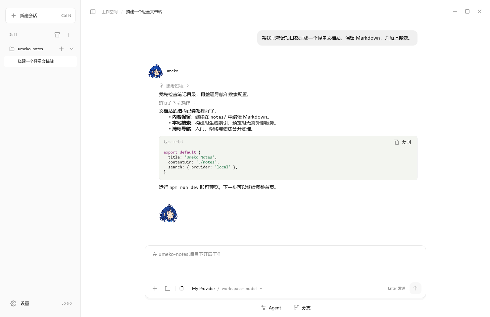

# Umeko Desktop C++

**让你的编程 Agent，在桌面安个家。**

[English](README.md) · [简体中文](README.zh-CN.md)

[下载应用](README.md#downloads) · [构建说明](docs/BUILDING.md) · [Provider SDK](provider_dev/README.md) · [Python 版](https://github.com/umeiko/umeko-desktop)

<!-- umeko-downloads:standard:start -->

**Download v0.6.3 · 点击下载**

<!-- umeko-downloads:standard:end -->

Umeko 是围绕项目组织聊天和任务的原生桌面应用。这个仓库使用 **C++20 与 Qt Quick**，共享 Python 版的界面和 Pi 运行适配层，桌面控制器采用原生 C++ 实现。

截图来自真实 C++ 应用，使用隔离的演示数据，不包含真实账号、凭据或模型请求。英文 README 展示英文界面，中文 README 展示中文界面。

## 主要特性

| 功能 | 使用体验 |
| --- | --- |
| 完整 Pi 内核 | 原生文件与终端工具、Skills、扩展、MCP、原生会话、分支和自动上下文压缩。 |
| 子智能体 | 独立的侧栏对话、草稿和附件；Enter 排队，Ctrl+S 强制介入，队列支持编辑、删除和引导。 |
| 多任务组织 | 默认解除 4 个子智能体的限制；重复角色带序号，较大的任务组折叠为可滚动矩阵。 |
| 清晰的工作过程 | 可折叠思考与工具记录、代码高亮、Markdown、附件和稳定滚动。 |
| 文档预览 | Markdown 与 HTML 支持源码和渲染视图，记住按类型选择的显示方式。 |
| 模型服务 | OpenAI 与 Anthropic 兼容服务、自定义供应商插件、逐模型设置、代理和 CA 证书。 |
| 桌面交互 | PID 弹窗动画、可拖动及松手吸附收起的侧栏、后台任务、托盘与原生通知。 |
| 自定义外观 | 中英文界面、可调字号、JSON 配色主题与角色互动。 |

文件可以直接拖入主聊天或子智能体对话，添加后聚焦输入框。子智能体使用对应角色的接取形象和完成头像；关闭侧栏不会停止任务。详见[子智能体说明](docs/subagents.md)。

## 开始使用

1. 点击[下载按钮](README.md#downloads)，获取 Windows、macOS 或 Linux 的完整安装包。
2. 保留整个应用目录，运行 `UmekoCpp.exe`、`UmekoCpp.app` 或 `./UmekoCpp`。
3. 在 **设置 → 账号与供应商** 添加服务或导入可信的供应商 ZIP。
4. 打开项目目录，选择模型开始对话。

发布包包含 **CPython 3.12.15、Node.js 22.23.3 与 npm**，无需单独安装 Python 或 Node.js。模型账号需要自行配置。平台要求、构建步骤和打包说明见[构建文档](docs/BUILDING.md)。

Agent 可以通过 `umeko_desktop` 管理应用的供应商、主题、设置、项目和会话，修改会实时刷新界面。`/help` 指向按主题组织的内置管理文档。

供应商 ZIP 与 Pi 扩展会执行本机代码，请使用可信来源。登录实现独立放在插件中，公开仓库不包含企业内网登录流程或私有地址。供应商配置与插件保留在用户目录中，升级应用无需重新导入。

这个项目由 [umeiko](https://github.com/umeiko) 创建，基于 [Pi Coding Agent](https://github.com/earendil-works/pi) 与 Qt。角色素材为独立同人项目的一部分，与原作权利人无隶属关系。依赖及许可见 [THIRD_PARTY_NOTICES.md](THIRD_PARTY_NOTICES.md)。

## Widget 插件

在「设置 → Agent → 插件管理」启用、导入 ZIP 或导出 SDK，聊天右下角可打开最近使用的插件。

- **文件管理器**：双击文件附加到聊天，右键进行文件操作。
- **版本管理**：修改列表、暂存、diff、提交记录与分支切换。
- **终端**：ANSI 着色、上下分栏和聊天附加；Agent 操作的就是用户看见的同一个终端。
- **桌宠**：原生动画服务，展示任务状态、支持点击互动和导入自定义形象。

Widget 支持会话级或应用级生命周期，也可作为无界面后台服务。通过 `umeko_desktop` 查询各插件文档、公开方法和消息回执。参见 [Widget SDK](plugin-runtime/README.md) 与 [通信说明](runtime/umeko-docs/widget-plugins.md)。
